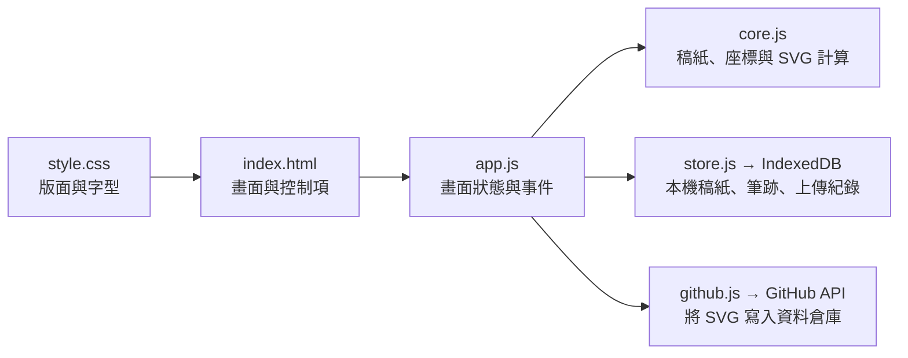

# InkTrace Web 專案導覽

InkTrace Web 讓使用者針對同一個題字，在左欄寫工整版、在右欄寫潦草版。每欄有自己的筆跡和上傳紀錄。GitHub Pages 提供網頁檔案，瀏覽器負責書寫、草稿保存與 SVG 匯出，使用者按下「上傳 GitHub」時才會將筆跡送往指定的資料倉庫。

## 1. 從哪裡讀起

先打開 [index.html](index.html) 找到畫面元件，再到 [app.js](app.js) 找該元件的事件。事件需要驗證資料、計算或匯出時，會使用 [core.js](core.js)。保存草稿與上傳則分別交給 [store.js](store.js) 和 [github.js](github.js)。

## 2. 檔案分工

| 檔案 | 負責的工作 |
| --- | --- |
| [`index.html`](index.html) | 頁面結構。包含首頁稿紙列表、搜尋、新增／改名表單、雙畫布、筆刷控制、進度、GitHub 設定和 JSON 匯入對話框。兩欄以 `data-board="regular"`、`data-board="rough"` 區分。 |
| [`style.css`](style.css) | 配色、卡片、按鈕、淺深色主題、桌面與手機版面。`@font-face` 指向內附字型，`.board-grid` 負責左右排列，`.paper` 負責方形字格與輔助十字。 |
| [`app.js`](app.js) | 整合網頁功能。管理目前稿紙與題字、監聽指標事件、畫灰字和黑色筆跡、更新控制項、處理匯入和下載、調用保存及上傳功能。 |
| [`core.js`](core.js) | 不依賴畫面元件的共用函式。驗證稿紙與字元、建立稿紙資料、計算筆壓和提示字置中、判斷完成進度、產生 SVG 及檔名。 |
| [`store.js`](store.js) | 操作瀏覽器 IndexedDB。建立資料庫、讀取全部稿紙、寫入或刪除稿紙，並在首次開啟時建立預設練習稿紙。 |
| [`github.js`](github.js) | 瀏覽器的 GitHub API 客戶端。檢查設定與 `main` 分支，查詢現有檔案的 SHA，新增或更新 SVG，並將 GitHub 錯誤轉成畫面訊息。 |
| [`.nojekyll`](.nojekyll) | GitHub Pages 的空白標記檔。使用分支部署時，Pages 直接提供靜態檔案。 |
| [`fonts/noto_sans_tc_thin.ttf`](fonts/noto_sans_tc_thin.ttf) | 左欄灰字使用的 Noto Sans TC Thin 100。 |
| [`fonts/ShoujinTi_GBK.ttf`](fonts/ShoujinTi_GBK.ttf) | 右欄灰字固定使用的方正瘦金書 GBK。 |
| [`fonts/shoujin-coverage.js`](fonts/shoujin-coverage.js) | 從瘦金體字型的 Unicode 對照表產生的字元覆蓋資料。`hasGlyph()` 讓右欄在缺字時留白。 |
| [`fonts/OFL.txt`](fonts/OFL.txt)、[`fonts/NOTICE.txt`](fonts/NOTICE.txt) | Noto Sans TC 的授權文字與來源。方正瘦金書的網站嵌入授權另見 README。 |

### 本機預覽、驗證與其他檔案

| 檔案 | 負責的工作 |
| --- | --- |
| [`app.py`](app.py) | 執行 `python app.py` 時啟動本機 HTTP 服務，預設網址為 `http://127.0.0.1:8082`。提供靜態檔案，也保留原先的 `/api/` 路由。現行網頁使用上表的 JavaScript。 |
| [`start.cmd`](start.cmd) | Windows 啟動器。尋找 Python 3.10 以上版本、啟動本機預覽，並在程式結束後保留視窗以便查看訊息。 |
| [`svg_export.py`](svg_export.py) | 舊版 Python API 使用的筆跡驗證、圓點／線段 SVG 產生與路徑處理。網頁上的輪廓 SVG 由 `core.js` 產生。 |
| [`github_client.py`](github_client.py) | 本機 Python API 使用的 GitHub 客戶端。網頁上的上傳由 `github.js` 處理。 |
| [`test_core.cjs`](test_core.cjs) | 用 Node.js 檢查稿紙解析、字元、筆壓、SVG、提示字置中和雙欄完成判斷。執行 `node test_core.cjs`。 |
| [`test_app.py`](test_app.py) | 檢查 Python SVG 和本機 HTTP 路由，使用模擬 GitHub 回應測試新增、更新和錯誤處理。執行 `python -B -m unittest -v test_app`。 |
| [`examples/天.svg`](examples/天.svg) | 300×300 的範例 SVG，可直接用瀏覽器開啟檢視。 |
| [`README.md`](README.md)、`ARCHITECTURE.md`、[`LICENSE`](LICENSE) | 部署與操作說明、本篇程式導覽、原始碼授權。 |
| [`.gitignore`](.gitignore) | 排除 Python 快取、環境設定檔和日誌等本機檔案。`__pycache__/` 是執行 Python 後產生的快取。 |

這份導覽以外層專案的 `index.html` 為入口。專案內若看到另一層同名的 `inktrace-web/`，那層是獨立的靜態副本。相鄰的 `inktrace-web.zip` 是部署包，包含靜態網頁、字型及相應的資源檔。

## 3. 網頁如何啟動與切換畫面

1. `index.html` 載入 `style.css`，再依序執行 `core.js`、`store.js`、`github.js`、`fonts/shoujin-coverage.js` 和 `app.js`。這些腳本使用 `defer`，可在 HTML 元件解析完成後按順序執行。
2. `app.js` 的 `init()` 開啟 `inktrace-web` IndexedDB、讀出稿紙、還原帳號與倉庫名稱。`renderHome()` 產生稿紙卡片。搜尋欄會依稿紙名稱過濾卡片。
3. `openPaper()` 選定稿紙與上次題字，顯示書寫頁。`selectCharacter()` 先結束進行中的筆畫，再切換題字、重畫灰字與筆跡並保存目前位置。
4. `renderEditor()` 根據目前狀態更新字元按鈕、完成數、上傳連結和按鈕可用性。淺／深／系統主題透過 `<html>` 的 `data-theme` 套用 CSS 變數，主題偏好存於 `localStorage`。

新增稿紙可直接輸入內容、匯入 UTF-8 TXT，或貼上含 `title` 和 `text` 的 JSON。`core.js` 會驗證名稱與內容、略過空白及換行，並保留重複的題字。題字陣列以 Unicode 字元切分，草稿則依陣列索引儲存。

## 4. 雙畫布、灰字與手機版面

### 字格分層

每一欄都有一個 `.paper`，內部疊著兩張畫布。CSS 畫輔助十字，`.guide-canvas` 畫灰字，`.writing-canvas` 接收輸入並畫黑色筆跡。灰字層的 `pointer-events: none` 讓事件傳給書寫畫布。兩欄共用題字、粗細、筆壓與「提示」開關，復原、清除和下載則各自處理。

### 指標事件與座標

`app.js` 使用 `pointerdown`、`pointermove`、`pointerup`，以相同事件處理滑鼠、觸控和觸控筆。每欄記住自己的 `pointerId`，用 `setPointerCapture()` 持續接收該筆畫的事件。放開、取消或失去指標捕捉時，由 `finishStroke()` 收尾並保存。`touch-action: none` 套在書寫畫布，避免手指寫字時頁面跟著捲動。

| 尺寸 | 用途 |
| --- | --- |
| 可變 CSS 尺寸 | 顯示在螢幕上的正方形。`fitCanvas()` 依兩欄的可用寬高取較小值，每欄最多 360 CSS 像素。 |
| 400×400 | 筆跡的邏輯座標。`readPointerPoint()` 會把螢幕位置換算到這個範圍，讓視窗縮放或旋轉後仍能重畫同一份資料。 |
| 1000×1000 | Canvas 繪製用的內部像素。`drawStrokes()` 用 2.5 倍的轉換繪製 400×400 筆跡。 |
| 300×300 | 下載和上傳的 SVG 尺寸。`core.js` 另行計算筆跡範圍及縮放。 |

筆畫是一串 `{ x, y, width }` 點。同一題字的左、右欄各有一組筆畫。觸控筆的壓力會依「筆壓」滑桿調整 `width`，滑鼠和一般觸控以固定壓力值計算。移動距離太短的採樣點會略過，畫布使用圓頭線段和圓點繪出筆跡。

### 灰字怎麼置中

`drawGuides()` 先用 `measureText()` 取得字形的可見邊界，再由 `core.js` 的 `fitBounds()` 算出等比縮放及位置。字形邊界的中心對準字格中心，最長邊約佔字格 85%。右欄須同時滿足字型載入成功及 `hasGlyph()` 找到該字，才會繪製灰字。缺字時留白，仍可書寫。

CSS 媒體查詢負責不同螢幕的控制面板位置，兩塊寫字板維持並排。`ResizeObserver`、視窗和可視區域的尺寸事件負責觸發畫布調整。進行中的筆畫會先結束，再因應視窗尺寸變化重排。

## 5. 草稿資料怎麼保存

IndexedDB 有 `papers` 和 `meta` 兩個資料表。`papers` 以稿紙 `id` 為索引，`meta` 記錄是否已初始化。每份稿紙保存 `title`、題字陣列 `chars`、最近選取的 `selected`，以及依題字索引存放的 `drafts`。

| 草稿欄位 | 內容 |
| --- | --- |
| `strokes` | 左欄筆畫。既有單畫布版本的筆跡也在這裡。 |
| `roughStrokes` | 右欄筆畫。尚無資料時初始化為空陣列。 |
| `uploaded` | 左欄成功上傳的紀錄。 |
| `roughUploaded` | 右欄成功上傳的紀錄。 |

上傳紀錄包含當次筆跡的 JSON 字串（`signature`）、SVG 格式版本（`svgFormat`）、稿紙名稱、目標倉庫與分支、時間、SHA 和 GitHub 網址。放筆、復原、清除、切字和上傳成功都會觸發保存。瀏覽器依網站來源隔離資料，因此 `localhost` 和 GitHub Pages 各有自己的草稿。

## 6. SVG 匯出及 GitHub 上傳

### 下載 SVG

`app.js` 的 `download(board)` 把指定欄的筆畫交給 `core.js` 的 `svg()`，GitHub 上傳也呼叫同一個函式。`prepareStroke()` 簡化採樣點、平滑座標與筆寬，並保留筆畫首尾。`buildContour()` 依筆畫方向取垂直偏移，以各點的半筆寬畫出兩側輪廓，再接上圓端。單點產生圓形輪廓，折返處可在同一筆的 `<path>` 內分成數段封閉子路徑。

匯出以輪廓邊界計算等比縮放，置中於 300×300 的 SVG。每筆是黑色填滿的 `<path>`，其中 `M` 起始、`L` 接點、`Z` 封閉。背景透明，灰字與十字留在畫面層。瀏覽器以 `Blob` 建立下載檔，檔名以「工整」或「潦草」區分。

### 上傳及完成狀態

1. `app.js` 選出目前題字有筆跡、且尚未上傳當前版本的欄位。`github.js` 檢查目標倉庫和 `main` 分支。
2. 每欄依序查詢目標路徑。檔案存在時取得其 SHA，寫入時附上 SHA。目標檔案不存在時，直接建立新檔。
3. GitHub 回傳 SHA 後，`app.js` 立即保存該欄上傳紀錄。若另一欄失敗，重試會繼續處理未成功或已修改的欄位。
4. `core.js` 的 `done()` 比對當前筆跡、稿紙名稱、上傳目的地與 SVG 格式版本。`pairDone()` 要求同一題字的兩欄都符合，才把該字計入完成數。舊格式的紀錄會顯示為待上傳，可用現有草稿更新成輪廓版。

| 欄位 | GitHub 路徑 |
| --- | --- |
| 左欄工整 | `font_dataset/稿紙名稱/字.svg` |
| 右欄潦草 | `font_dataset/稿紙名稱/潦草/字.svg` |

重複題字的本機草稿依索引區分。遠端路徑依題字命名，同一稿紙的同字、同欄重傳會更新同一檔案。GitHub 帳號和倉庫名稱可存在 `localStorage`，Token 只在當前頁面的 `githubSettings` 記憶體中，重新整理後需重新輸入。

## 7. 想改某個細節時，去哪裡找

| 想調整的項目 | 入口 |
| --- | --- |
| 頁面文字、按鈕、對話框 | `index.html`。改 ID 或 `data-action` 時，同步檢查 `app.js` 的事件查找。 |
| 首次啟動的預設稿紙 | `store.js` 的 `init()`。這段只在該瀏覽器首次初始化時建立預設稿紙。 |
| 字格大小、手機間距、配色 | `style.css` 的 `.writing-mode`、`.board-grid`、媒體查詢，以及 `app.js` 的 `fitCanvas()`。 |
| 左右欄提示字、灰度或佔格比例 | `style.css` 的 `@font-face`，`app.js` 的 `drawGuides()`，以及 `core.js` 的 `fitBounds()`。右欄的覆蓋表須與字型檔一致。 |
| 書寫手感或筆壓 | `app.js` 的指標事件與 `readPointerPoint()`，以及 `core.js` 的 `width()`。 |
| SVG 的尺寸、縮放或圖形 | `core.js` 的 `svg()`。瀏覽器下載與 GitHub 上傳會共用這個輸出。 |
| 遠端路徑、分支或上傳錯誤訊息 | `github.js` 的 `upload()`、`check()` 和 `request()`。調整分支時，也要檢查 `app.js` 的目的地判斷。 |

部署操作見 [README.md](README.md)。Pages 版本的入口是 `index.html`，網站資源使用相對路徑，放在 `/<repo>/` 專案子目錄也能載入。開發時可用 `python app.py` 在本機預覽同一份前端。
